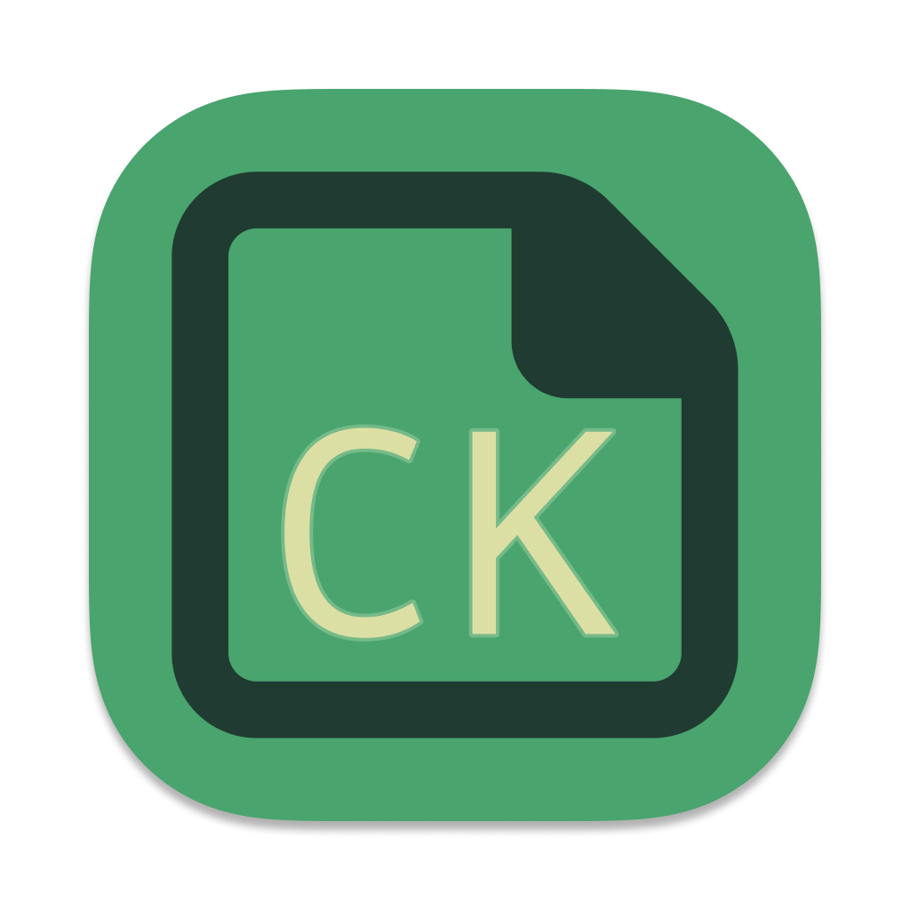

#  flashCK

Create, edit and study flashcards.

## Downloads

### macOS

<!-- Quick Reference -->
<table border="0">
<tbody>
<tr>
<td align="center" valign="top"></td>
<td align="center" valign="top"></td>
</tr>
</tbody>
</table>
<!-- End Quick Reference -->

## Compatibility

| Platform | Version | Architecture |
|----------|---------|--------------|
| macOS | 12 Monterey or later | x64, arm64 (universal) |

## First launch

flashCK is not notarized by Apple, so macOS blocks it the first time you open it.

- macOS 15 Sequoia or later: open flashCK and click Done, then open System Settings > Privacy & Security, click Open Anyway next to flashCK, and confirm.
- macOS 12 to 14: Control-click flashCK in Finder, choose Open, then click Open.

## Data

Your library is saved in `~/Library/Application Support/flashCK/`. The `backups` folder there keeps the 10 most recent versions from launches where the library changed.
